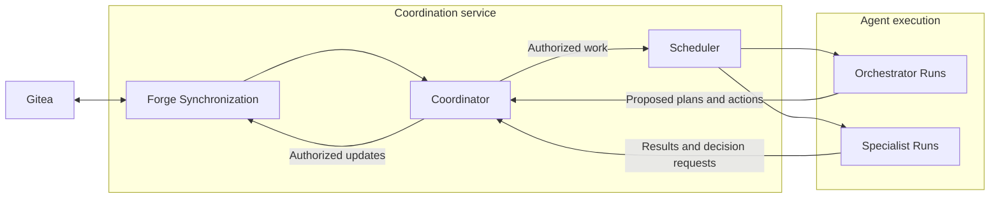

# High-level architecture

The logical architecture and delivery workflow include [waiting/recovery](workflow.md#waiting-and-recovery) and [human controls](workflow.md#human-controls-and-scope-changes). The [context continuity and shared-work handoff](workflow.md#proposed-context-continuity-and-shared-work) is proposed for discussion. Persistence ownership follows D-05, D-07, and D-11; detailed component contracts and infrastructure follow separately. Design agreement does not establish implementation or verification.

This document describes the system boundary, main parts, information ownership, and their relationships. [Definitions](definitions.md), [requirements](requirements.md), [decisions](decisions.md), and [responsibilities](responsibilities.md) remain the governing sources for terminology, required behavior, selected technologies, and actor responsibilities.

## System boundary

Möbiræon coordinates software delivery from a human Request to an accepted outcome. It connects clarification, planning, Agent assignments, production of Deliverables, independent assessment, and acceptance under the governing baseline and policy.

The human establishes intent and delegated authority. Agents contribute reasoning and work. Coordination enforces the rules governing what can proceed and what can be accepted.

The product supports the work described in the [product overview](../README.md). The first pilot is the bounded feature in an existing repository defined by [D-12](decisions.md#d-12-first-live-validation-and-release-scope).

## Main parts

| Part | Responsibility |
| --- | --- |
| **Human interface** | Receive Requests, present progress and evidence, and capture human Decisions and approvals. Local Gitea is the initial interface; its forge adapter translates supported actions into validated coordination operations. |
| **Coordination** | Maintain authoritative work state, enforce policy, prerequisites, ownership, limits, and acceptance gates, and schedule eligible work. Contains the Coordinator and deterministic Scheduler. |
| **Agent execution** | Execute bounded Runs for the Orchestrator and specialist Agents. Workers provide capacity; Runner Adapters invoke configured runtimes, supervise execution, and return normalized outcomes under the applicable controls. |
| **Agent Registry** | Maintain the persistent, versioned catalog of Agent identities, Profiles, and instruction references. Supply specific published configuration revisions for assigned work. |
| **Artifacts and context** | Retain and make discoverable governing documents, source revisions, Deliverables, and verification evidence. Preserve identifiable versions and the distinction between produced material and accepted results. |

These are logical responsibilities. Their grouping does not require a separate service or database for each part.

The [high-level Mermaid system diagram](diagrams/high-level.md) shows these five parts, their main exchanges, and the Coordinator's ownership of operational state. The [focused workflow diagrams](diagrams/README.md) cover the confirmed intake/readiness, assignment/selection, shared Run lifecycle, assessment/rework, and integration/validation models.

## Coordination and Agent reasoning

The **Coordinator** authorizes operations and maintains authoritative workflow state. The **Scheduler** determines when eligible, authorized work can run within the available capacity and limits. Both apply deterministic rules.

The **Orchestrator Agent** reasons about intake, plans, Assignments, and Decisions. It proposes actions through authorized Coordinator operations and executes through the same controlled execution boundary as specialist Agents. Only it may initiate agent-generated requests for human decisions or intervention; ordinary human review follows project policy.

Specialist Roles supply architecture, writing, development, review, verification, and decision investigation as required. The [role catalog](roles/README.md) owns their instructions. Roles, Agent identities, Profiles, Workers, and Runs remain distinct; a Role description or model response grants no permissions.

Policy enforcement and integration control belong within these coordination and execution boundaries. Acceptance is recorded by the Coordinator when the designated authority and required evidence establish it.

### Initial Coordination operating model

Run Coordination as one dedicated background service, containing a distinct **Forge Synchronization** component alongside the Coordinator and Scheduler. Initially this component polls Gitea through the in-process forge adapter and publishes authorized updates back to it. This separates polling responsibility within the single-service baseline in D-07 and D-11.

| Responsibility | Owner |
| --- | --- |
| Discover new or changed managed Gitea items, including relevant human replies and review activity; publish authorized status and work-item updates | Forge Synchronization, through the forge adapter |
| Reconcile observations with internal records; enforce authority, prerequisites, ownership, and limits; record authorized Assignments and acceptance | Coordinator |
| Interpret Requests, clarify intent, decompose work, and propose suitable Roles, Agent/Profile selections, Assignments, and Decision resolutions | Orchestrator Agent, in bounded Runs |
| Dispatch already authorized, eligible Runs according to configured scheduling rules and available capacity | Scheduler |
| Start and supervise the selected Agent's Run, returning results and evidence | Agent execution, through Workers and Runner Adapters |

A configured intake rule identifies an eligible Orchestrator Agent/Profile for a new Request needing interpretation. The Coordinator authorizes a bounded intake Assignment, and the Scheduler dispatches its Run through the normal execution boundary. Subsequent Role and Agent/Profile selections can come from the Orchestrator's validated proposals or an already approved explicit assignment rule. The Scheduler applies those selections without interpreting issue prose or inventing a plan.

A new Gitea issue is an observed input. Its managed scope, meaning, authority, and required context must be established before it becomes executable work. An unplanned Task may need clarification; a mapped, already planned Task can proceed directly when its recorded Assignment and prerequisites permit. Repeated observations of the same item, including Möbiræon's own status updates, must not create duplicate Requests, Assignments, or Runs.

Polling, synchronization, scheduling, and reconciliation use ordinary software. The Orchestrator runs when actionable interpretation, planning, routing, or decision reasoning is required. Known workflow progression and internal results can make work eligible independently of a fresh Gitea change; neither dispatch nor continuation waits for a new issue to appear.

Gitea documents an [issue search API](https://docs.gitea.com/api/operations/issue-search-issues/) and [webhook notifications](https://docs.gitea.com/usage/repository/webhooks/). Polling is the agreed initial observation mechanism; webhooks may later complement it through the same adapter and Coordinator boundary. Detailed event coverage, intake conventions, actor verification, and qualification of the installed Gitea version belong to the forge contract. The corresponding high-level operating loop is in [workflow](workflow.md#coordination-loop).

## Persistence and information ownership

Persistence is part of the responsibilities above. The Registry preserves how Agents are configured; Coordination preserves work state and acceptance; Artifacts and context preserve the versioned material used and produced by that work.

| Information | Authoritative owner | Confirmed persistence boundary |
| --- | --- | --- |
| Registered Agent identities, Profile revisions, and published instructions | Agent Registry | Dedicated Git repository containing JSON configuration and Markdown instructions; published revisions are identified by exact Git commits. See [D-05](decisions.md#d-05-registry). |
| Requests, Initiatives, Tasks, Assignments, Runs, dependencies, Decisions, ownership, waiting conditions, acceptance, and audit history | Coordination | SQLite on local persistent disk, with authoritative changes controlled by the Coordinator. Includes immutable per-Run configuration records and links to governing context and evidence. See [D-11](decisions.md#d-11-implementation-technology-and-topology). |
| Requirements, specifications, source changes, Deliverables, and substantial verification evidence | Artifacts and context | Versioned repositories and separately retained artifacts with durable, versioned references. Coordination records which revisions govern work and which have been accepted. |
| Human-facing issues, milestones, pull requests, and discussions | Human interface / forge | Native forge records with explicit mappings to internal records. Workflow state and acceptance remain authoritative in Coordination. See [D-07](decisions.md#d-07-forge-integration-and-initial-platform). |
| Credential values | Authorized secret-management mechanism | Configuration and retained records use secret references; secret values stay outside model-visible context, exports, logs, and audit records. |

The Registry therefore needs logic to validate, publish, retain, and retrieve configuration revisions. Git supplies its durable version history; the configuration contract governs what can be published and used. Detailed schemas, catalog organization, and permitted overrides follow [D-05](decisions.md#d-05-registry) and the [Agent configuration contract](requirements.md#agent-configuration-contract).

Worker availability, active Runs, and execution history belong to Coordination. A registered Agent can exist without a running process. Before dispatch, each Run binds to exact configuration and context revisions; later Registry publication does not silently change that Run. Changes to governing inputs trigger reassessment while preserving its original records.

## Main exchanges

These exchanges describe component relationships, rather than an ordered delivery workflow.

| Relationship | Information exchanged and boundary |
| --- | --- |
| Human ↔ Coordination, through the human interface | Requests, clarification, authorized Decisions and approvals, progress, evidence, and required human action. Forge actions request validated operations; an issue closure alone cannot establish acceptance. |
| Agent Registry → Coordination | Published Agent and Profile revisions and their referenced instructions and execution settings. Coordination resolves and validates them for the particular Run before dispatch. |
| Coordination → Agent execution | An authorized Assignment and Run with resolved configuration, governing context, acceptance criteria, permissions, and limits. Dispatch also requires readiness, qualified capabilities, and available capacity and budget. |
| Agent execution → Coordination | Proposed actions, Run outcomes, internal decision requests, Artifact references, and evidence of the validation actually performed. Results remain subject to current ownership, policy, and revision checks. |
| Agent execution ↔ Artifacts and context | Read the assigned governing sources and produce versioned work and evidence within authorized workspace and repository boundaries. |
| Coordination ↔ Artifacts and context | Resolve governing revisions, track dependency satisfaction and assessment evidence, and associate acceptance with exact Deliverable revisions. Summaries retain source and freshness information and link to governing sources. |

## Shared architectural rules

- **Authority and acceptance:** Coordination validates proposed actions. Run completion, independent assessment, and acceptance are separate facts; acceptance requires the designated authority and evidence.
- **Revision traceability:** Work, dependencies, review, and acceptance refer to identified governing inputs and result revisions. Overall code delivery requires validation of the exact combined revision.
- **Controlled execution:** Trusted controls enforce permissions and limits. Roles, retrieved content, and Agent outputs cannot expand authority.
- **Durable progress:** Waiting, interruptions, and reassignment preserve work and its history. Blocked work releases execution capacity; monitoring does not require idle model calls.

These rules summarize the approved [requirements](requirements.md); their concrete enforcement belongs to the following design layers.

## Following design layers

The initial implementation choices remain those in [D-06](decisions.md#d-06-execution-boundary), [D-07](decisions.md#d-07-forge-integration-and-initial-platform), [D-08](decisions.md#d-08-initial-profiles), and [D-11](decisions.md#d-11-implementation-technology-and-topology): Linux with isolated container Workers, local Gitea, staged qualification of the requested execution paths, and Python with one active Coordinator/Scheduler service and SQLite. They constrain subsequent design without requiring infrastructure detail in this view.

Component contracts, storage schemas, deployment, enforcement mechanisms, operating values, and qualification remain follow-up specifications tracked in the [readiness review](implementation-readiness-review.md). Exact lifecycle states, transitions, review/rework progression, and recovery procedures belong to the [workflow](workflow.md) specification. These details do not become agreed merely through agreement on the five-part structure.
