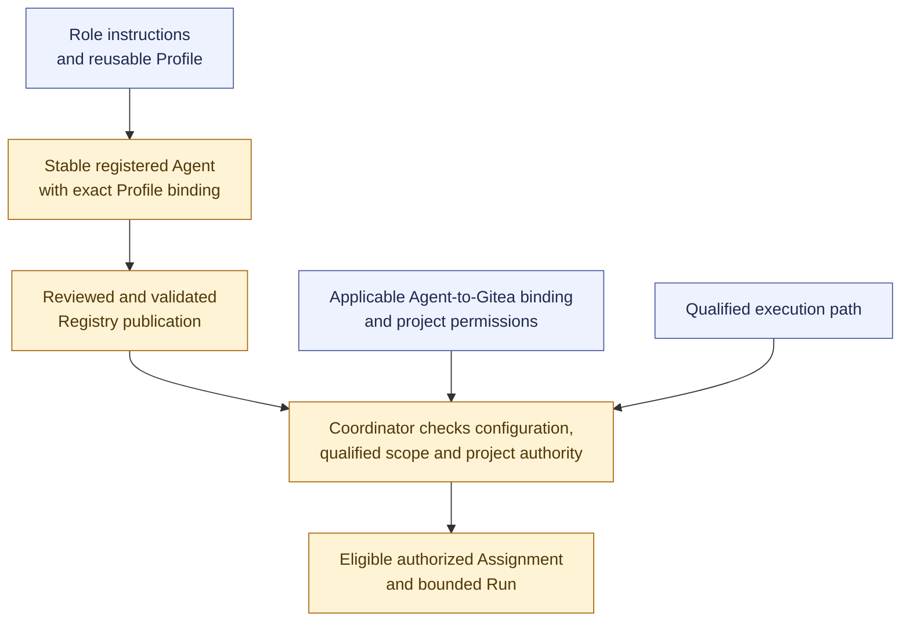

# Agent setup and Gitea integration

**[P] High-level onboarding and forge-identity proposal.** Git-based Registry persistence is already established. The [setup discussion](../pilot-and-agent-setup.md#registry-and-gitea-identities) proposes account bindings; the [workflow](../workflow.md#proposed-agent-onboarding) describes preparation.

Registry publication retains configuration; Coordination retains operational state and per-Run records. Forge identities and model-provider identities are distinct. Account access complements workflow permission and independence checks rather than replacing them.

Where a forge account is required, bind it through project integration configuration with secret references. Credential values remain in the authorized secret mechanism. New configuration revisions affect later validated selections and do not rewrite existing Runs.

This view shows preparation relationships rather than mandating a separate service, account for every Role or Run, or a particular provisioning mechanism. Continue with the [pilot proposal](../pilot-and-agent-setup.md#demonstration-pilot). Return to the [diagram guide](README.md).
