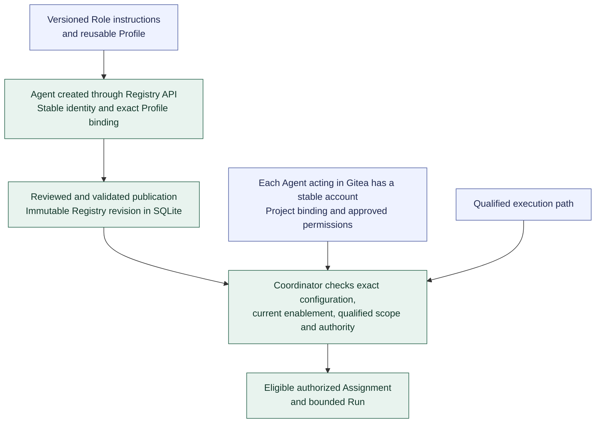

# Agent setup and Gitea integration

**[A] High-level Agent setup.** The [setup model](../pilot-and-agent-setup.md#registry-and-gitea-identities) defines stable forge-account bindings; the [workflow](../workflow.md#agent-onboarding) describes preparation through the Python/SQLite Registry API. [First-Agent preparation](../agent-registry.md#first-agent-preparation) defines the initial catalog and administrator-led bootstrap.

Registry publication retains configuration independently of Gitea; Coordination retains operational state and per-Run records. The Coordination service uses a separate Gitea account. Internal Agent, forge, and model-provider identities are distinct. Account access complements workflow permission and independence checks rather than replacing them.

Where a forge account is required, bind it through project integration configuration with secret references. Credential values remain in the authorized secret mechanism. New configuration revisions affect later validated selections and do not rewrite existing Runs.

This view shows preparation relationships rather than mandating a separate service, account for every Role or Run, or a particular provisioning mechanism. Continue with the [pilot setup](../pilot-and-agent-setup.md#demonstration-pilot). Return to the [diagram guide](README.md).
