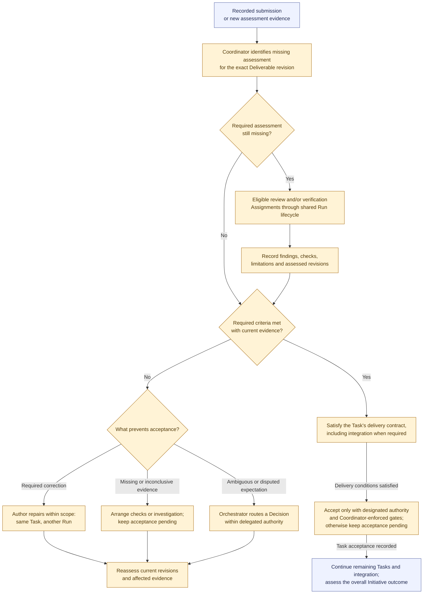

# Assessment, acceptance, and rework

**Snapshot: 2026-10-31.** The routing in amber is **[P] proposed** for discussion. Independent review, designated acceptance authority, and revision-specific evidence are already required by the agreed baseline. This view describes responsibility and progression, not exact states or a mandatory sequence of review and verification. See the [workflow proposal](../workflow.md#proposed-review-verification-acceptance-and-rework).

Each new submission or assessment result enters at the top. After correction, investigation, or a Decision, continue with current evidence through that same entry point. Every Agent Assignment uses the [shared Run lifecycle](run-lifecycle.md); the Coordinator does not perform model reasoning or execute checks itself.

Independent review assesses correctness, completeness, and conformance. Verification supplies check results and environment evidence; its timing and overlap follow the work contract. Separate Role names or models do not establish independence. A failed check is a finding about the work; a failed verifier execution follows Run recovery instead.

Acceptance remains pending while any required criterion, evidence, finding, or authority is unresolved. The Coordinator records the authorized determination and accepted revisions. An eligible reviewer can hold delegated acceptance authority; the model does not require an extra acceptance Run or fresh human approval for every Task. Only the Orchestrator initiates human escalation when resolution exceeds delegation. Changes to scope or governing contracts require the authorized Decision and artifact updates before affected work resumes.

| Delivery contract | What acceptance requires |
| --- | --- |
| Documentation or planning Task | Independent assessment and authorized acceptance of its own versioned Deliverable. |
| Reviewed-patch Task with separately assigned integration | Its own criteria may be accepted while the linked integration obligation continues. |
| Task requiring integrated code | Authorized integration and fresh validation of the exact combined revision before its acceptance. |
| Overall code delivery / Initiative | All required delivery obligations and overall outcome criteria, including applicable integrated validation. Accepted Tasks alone do not establish this. |

Conflicting target changes are serialized. Changes to a submission, governing input, or target revision require reassessment of affected evidence; reuse needs an explicit applicability determination. Rework retains Task identity, previous submissions, findings, and configuration history. Retry recovers execution; rework corrects assessed work. Neither exhaustion, silence, a closed issue, nor a merge establishes acceptance.

Previous: [Run lifecycle](run-lifecycle.md). Follow-up work returns to [assignment and selection](assignment-and-selection.md). Return to the [diagram guide](README.md).
