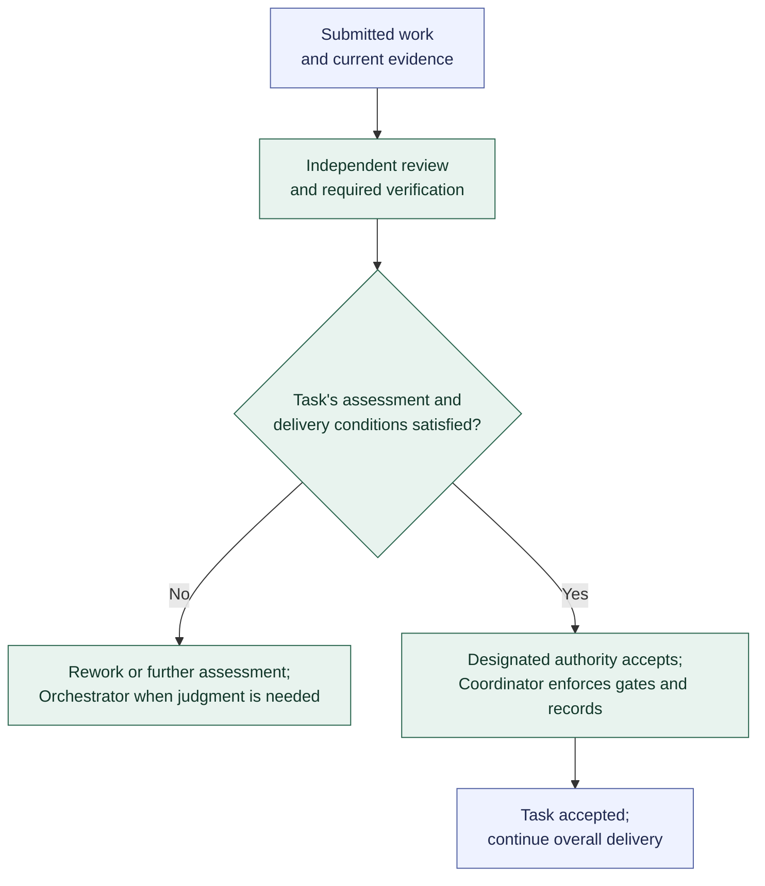

# Assessment, acceptance, and rework

**[A] Agreed high-level model and initial defaults.** This view summarizes responsibilities and outcomes, not exact states, a fixed assessment order, or implementation procedures. See the [workflow](../workflow.md#review-verification-acceptance-and-rework).

Use existing applicable evidence and arrange the missing assessment. After correction, investigation, or a Decision, return with the current revision and evidence. Every Agent Assignment uses the [shared Run lifecycle](run-lifecycle.md); the Coordinator enforces the rules while specialist Agents assess the work.

Independent review assesses correctness, completeness, and conformance. Verification supplies check results and environment evidence; its timing and overlap follow the work contract. Separate Role names or models do not establish independence. A failed check is a finding about the work; a failed verifier execution follows Run recovery instead.

The [initial defaults](../workflow.md#initial-defaults) establish routine routing without another Orchestrator Run, explicitly delegated ordinary Task acceptance by an eligible independent reviewer, and integration within ordinary implementation Task contracts unless assigned separately. Independence and all acceptance gates still apply.

Acceptance remains pending while any required criterion, evidence, finding, or authority is unresolved. The Coordinator records the authorized determination and accepted revisions. An eligible reviewer can hold delegated acceptance authority; the model does not require an extra acceptance Run or fresh human approval for every Task. Only the Orchestrator initiates human escalation when resolution exceeds delegation. Changes to scope or governing contracts require the authorized Decision and artifact updates before affected work resumes.

| Delivery contract | What acceptance requires |
| --- | --- |
| Documentation or planning Task | Independent assessment and authorized acceptance of its own versioned Deliverable. |
| Reviewed-patch Task with separately assigned integration | Its own criteria may be accepted while the linked integration obligation continues. |
| Task requiring integrated code | Authorized integration and fresh validation of the exact combined revision before its acceptance. |
| Overall code delivery / Initiative | All required delivery obligations and overall outcome criteria, including applicable integrated validation. Accepted Tasks alone do not establish this. |

Conflicting target changes are serialized. Changes to a submission, governing input, or target revision require reassessment of affected evidence; reuse needs an explicit applicability determination. Rework retains Task identity, previous submissions, findings, and configuration history. Retry recovers execution; rework corrects assessed work. Neither exhaustion, silence, a closed issue, nor a merge establishes acceptance.

Previous: [Run lifecycle](run-lifecycle.md). The [integration and validation view](integration-and-validation.md) expands the delivery-conditions gate for implementation Tasks. Follow-up work uses [assignment and selection](assignment-and-selection.md). Return to the [diagram guide](README.md).
