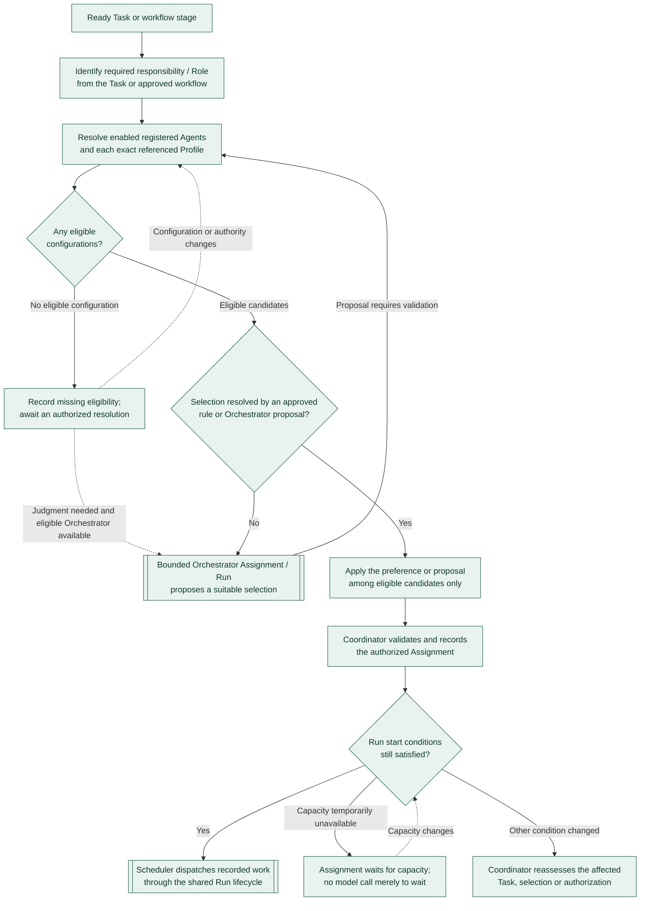

# Assignment and Agent selection

**Snapshot: 2026-10-31. [A] Agreed high-level behavior.** This view follows [Agent assignment and selection](../workflow.md#agent-assignment-and-selection). It separates Task readiness, configuration eligibility, and Run dispatch without defining exact state names or selection contracts. Agreement does not mean implemented or verified.

Eligibility covers the Role, capabilities, qualified execution scope, permissions, limits, and review independence. Each selected registered Agent revision retains its exact `profileRef`; its Profile's `roleRef` and instruction bindings must cover the responsibility. The Scheduler does not attach an arbitrary Profile or model, and Role text grants no permissions. Authorized changes follow the versioned Registry process.

Missing Agent eligibility and temporary lack of capacity do not alone remove Task readiness. Loss of required inputs or governing authority does trigger [readiness reassessment](intake-and-readiness.md). An unresolved choice is visible even when no eligible Orchestrator can run; it never authorizes an unqualified fallback. Ordinary approved selections require no additional reasoning Run.

The Assignment records the authorized allocation and governing references; it does not start execution. Run start rechecks readiness, authority, ownership, qualified configuration, capacity, and limits through the [shared Run lifecycle](run-lifecycle.md), including the immutable configuration record. Review uses a separate Assignment and Run under the independence policy; a different Agent name, Role, Profile, or model alone is insufficient.

Previous view: [Intake and readiness](intake-and-readiness.md). After execution: [Assessment and rework](assessment-and-rework.md).
