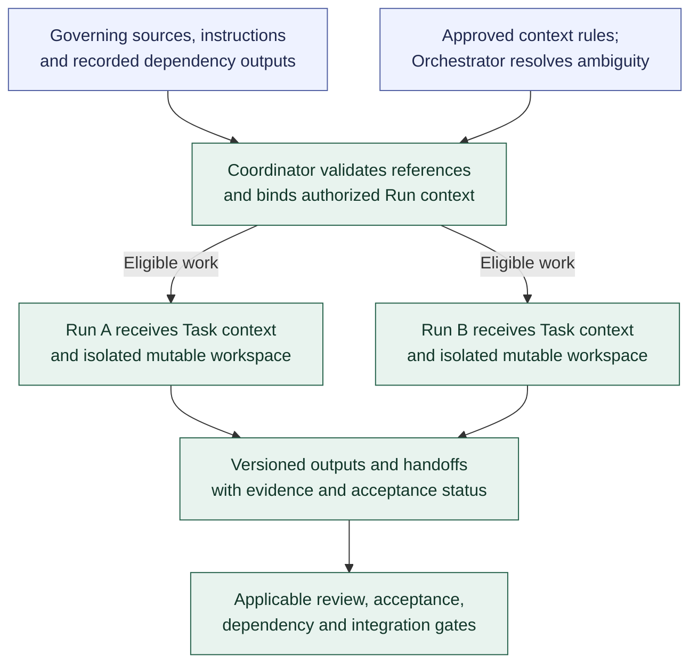

# Context continuity and shared work

**[A] High-level context and shared work.** This view summarizes context provision, durable handoffs, and isolated parallel work; see the [workflow](../workflow.md#context-continuity-and-shared-work).

Context includes shared rules, Role instructions, the Assignment, governing criteria and source revisions, relevant Decisions, and prerequisite outputs. Routine assembly follows approved policy; Agents inspect the sources and report missing or conflicting context. Execution resolves permitted content through the [shared Run lifecycle](run-lifecycle.md), including normal dispatch and authority checks.

Durable sources and handoffs carry continuity across Runs and reassignments, including partial work and unresolved findings. Summaries identify their sources and freshness; conversations and retrieved content cannot grant authority. Review context follows the independence policy. A progress Artifact is not automatically an accepted dependency.

Tasks can proceed in parallel where dependencies and stable contracts allow. Their mutable workspaces are isolated even when they edit the same source paths. Shared contracts, test state, and integration targets need coordinated changes. Governing changes trigger reassessment of affected work rather than silently changing an existing Run's bound context.

Related: [assignment and selection](assignment-and-selection.md), [integration and validation](integration-and-validation.md), and [human controls](human-controls.md). Return to the [diagram guide](README.md).
