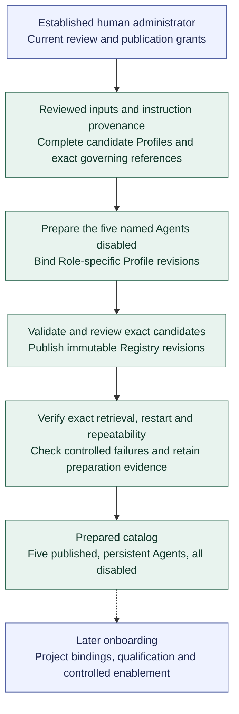

# First-Agent preparation

**[A] Inputs, disabled catalog, and preparation evidence.** This view shows the bounded Increment 2 result and its handoff to later onboarding without defining exact states or API commands. See the [bootstrap inputs and preparation evidence](../agent-registry.md#bootstrap-inputs-and-preparation-evidence) and the broader [first-Agent preparation](../agent-registry.md#first-agent-preparation).

First-owner setup applies only while administrative access is uninitialized; catalog preparation uses established administration. The [administrator access view](registry-access.md) covers current permissions and owner-controlled recovery. No running Orchestrator or Agent Run is required. The focused [authoring and publication view](registry-publication.md) governs drafts and exact-content review; the same authorized human may perform these administrative actions where policy permits.

Inputs include identified shared rules and Role snapshots, complete settings for one primary candidate execution path, and exact governing instruction, capability, policy, context, output, and applicable fallback references. Credential values stay outside the Registry and model context. Required missing values keep affected definitions in draft; test fixtures establish Registry mechanics separately from the prepared catalog.

Evidence retains the five Agent/Profile revisions, dependencies, current disabled state, instruction provenance, and attributable review records. Restart preserves them; repeat or resumed preparation creates no duplicates or silent overwrites. Conflicts require explicit reconciliation. Missing references, invalid settings, unauthorized or stale changes, and failed publication produce truthful outcomes with no partial published result for the failed publication. Keep a concise generated preparation record alongside Increment 2 submission evidence, identifying application and input versions, performed checks, results, and limitations.

The prepared catalog completes Increment 2's bootstrap outcome. Project integration, runtime qualification, enablement, and execution follow their applicable later gates. Authorized qualification checks cannot override disablement or revoked access.

Continue with the agreed [Agent setup](agent-setup-and-gitea.md) or [Run lifecycle](run-lifecycle.md), or return to the [diagram guide](README.md).
