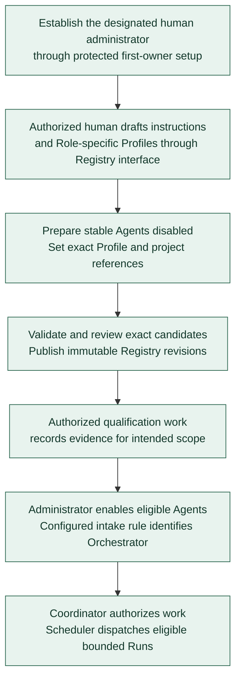

# First-Agent preparation

**[A] Bootstrap and initial enablement.** This view applies the Registry and onboarding model to the first Agents without defining exact states or API commands. See [first-Agent preparation](../agent-registry.md#first-agent-preparation) for the initial catalog and administrator-led setup.

First-owner setup applies only while administrative access is uninitialized; later catalog preparation uses established administration. The [administrator access view](registry-access.md) covers current permissions and owner-controlled recovery. Bootstrap needs no running Orchestrator. The focused [authoring and publication view](registry-publication.md) describes drafts and exact-content review; the same authorized human may perform these administrative actions where policy permits. Creating, publishing, qualifying, and enabling configuration remain distinct from assigning work. Authorized qualification checks evaluate the candidate execution configuration independently of dispatching a disabled Agent; they cannot override disablement or revoked access. Separate QA Runs follow the contract rather than being required for every Task. Credential values remain outside the Registry and model context.

Continue with the agreed [Agent setup](agent-setup-and-gitea.md) or [Run lifecycle](run-lifecycle.md), or return to the [diagram guide](README.md).
