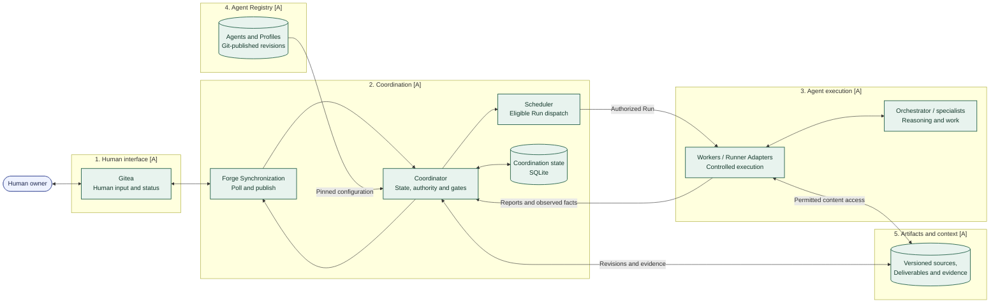

# High-level system diagram

**Snapshot: 2026-10-31.** All five logical parts and the responsibility boundaries in this view are agreed. [A] means agreed design, not implemented or qualified. The [architecture](../architecture.md) owns the component descriptions; the [diagram guide](README.md) explains versioning and status markers.

The Coordinator is the authority for workflow changes; Agent proposals, forge observations, and process exits are inputs to its controls. Workers submit results through that boundary. The Registry retains configuration, Coordination retains operational records and acceptance, and Artifacts/context retain the versioned material.

These are logical parts, not a requirement for five separate services. Credentials use a separately authorized secret mechanism, and execution uses the configured, qualified runtime/provider path. Detailed infrastructure and workflow progression are outside this view.

Continue with [intake and readiness](intake-and-readiness.md), or choose a focused view from the [diagram guide](README.md).
