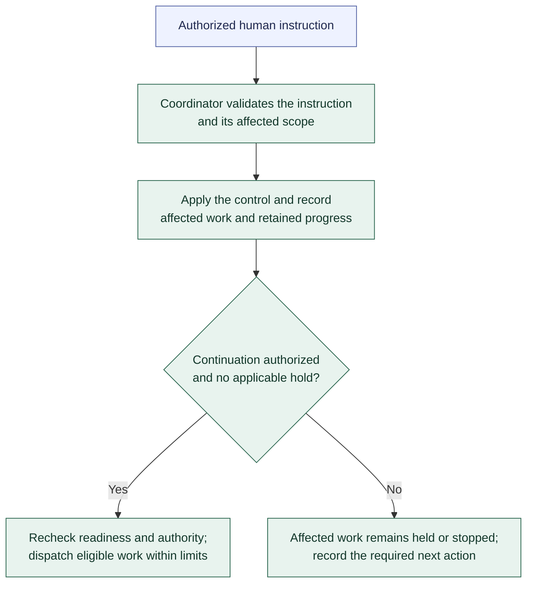

# Human controls and scope changes

**[A] High-level human controls.** Authorized human instructions reach the Coordinator directly. The [workflow](../workflow.md#human-controls-and-scope-changes) describes pause, resume, cancellation, reprioritization, takeover, and scope changes.

Pause holds new starts and winds down affected Runs under supervision. Resume lifts only the selected hold and rechecks current conditions. Cancellation ends selected work without implying acceptance or undoing existing effects. Reprioritization changes eligible pending order without automatic preemption.

Takeover holds affected automation, retires prior execution ownership, and cleans up or contains its processes before exclusive human work. Human-produced changes remain subject to normal evidence and acceptance rules. Returning to automation is explicit and requires current checks through a new Run when execution is needed.

Controls persist across restart and apply to explicit scope; Request-level controls use validated delivery links. A narrower resume does not override broader holds or cancellation. Cancelled work requires new authorization to continue. Authorized scope changes update governing context and trigger reassessment of affected work and evidence; independent work may continue.

Recording a control request is distinct from establishing that active execution has stopped. Cleanup or effective containment still governs capacity reuse. These responsibilities do not select exact states, timing, or control mechanisms.

Related: [waiting and recovery](waiting-and-recovery.md). Return to the [diagram guide](README.md).
