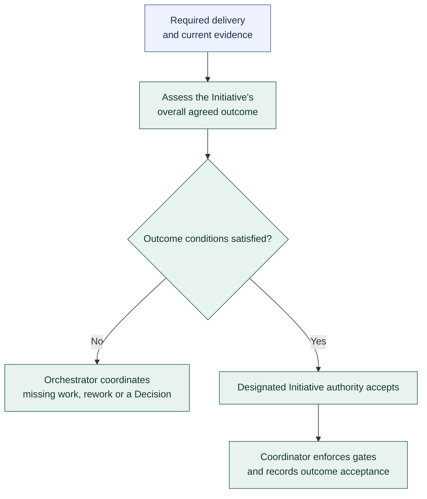

# Initiative outcome acceptance

**[A] High-level outcome acceptance.** This view summarizes the outcome-assessment handoff and Initiative-level authority; see the [workflow](../workflow.md#initiative-outcome-acceptance).

The Orchestrator coordinates assessment and gaps; reviewers and verifiers supply the necessary judgments and evidence. Applicable existing evidence can be reused. Every Agent Assignment uses the [shared Run lifecycle](run-lifecycle.md).

The acceptance default is an eligible independent Reviewer with explicit Initiative-level delegation. Task-level reviewer authority does not automatically extend to the Initiative. Human acceptance follows the project policy.

Required delivery, current outcome evidence, and the absence of unresolved required blockers govern completion. Accepted Tasks alone do not establish the overall outcome. Missing work returns through [assessment and rework](assessment-and-rework.md); Request fulfillment and later defects or changed goals follow [Request closure and follow-up](request-closure-and-follow-up.md).

Related: [integration and validation](integration-and-validation.md). Continue with [Request closure and follow-up](request-closure-and-follow-up.md). Return to the [diagram guide](README.md).
