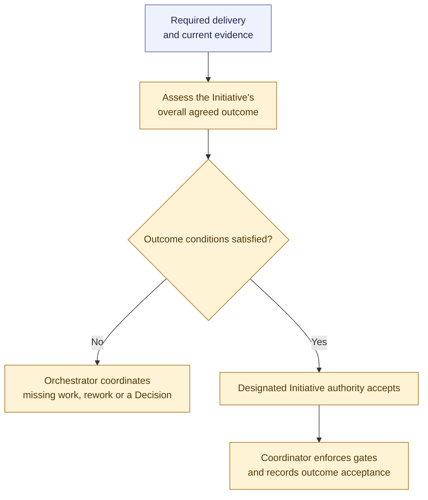

# Initiative outcome acceptance

**[P] Proposed outcome-assessment handoff and authority default.** Overall outcome acceptance is already required by the baseline. This view summarizes responsibilities and outcomes; see the [workflow proposal](../workflow.md#proposed-initiative-outcome-acceptance).

The Orchestrator coordinates assessment and gaps; reviewers and verifiers supply the necessary judgments and evidence. Applicable existing evidence can be reused. Every Agent Assignment uses the [shared Run lifecycle](run-lifecycle.md).

The proposed acceptance default is an eligible independent Reviewer with explicit Initiative-level delegation. Task-level reviewer authority does not automatically extend to the Initiative. Human acceptance follows the project policy.

Required delivery, current outcome evidence, and the absence of unresolved required blockers govern completion. Accepted Tasks alone do not establish the overall outcome. Missing work returns through [assessment and rework](assessment-and-rework.md); Request closure and later follow-up are covered by the [remaining discussion agenda](../implementation-plan.md#remaining-high-level-discussions).

Related: [integration and validation](integration-and-validation.md). Return to the [diagram guide](README.md).
