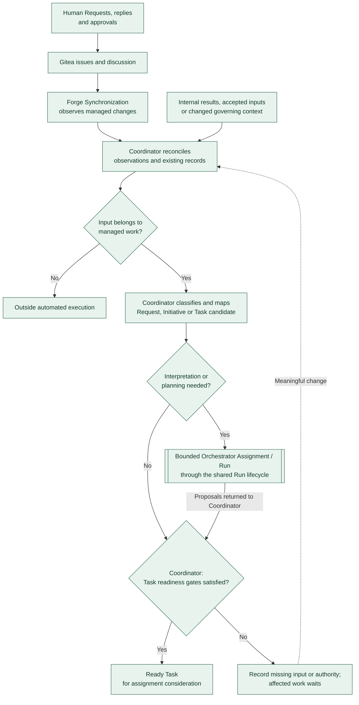

# Intake and Task readiness

**Snapshot: 2026-10-31. [A] Agreed high-level behavior.** This view follows [intake and readiness](../workflow.md#intake-and-task-readiness). It shows local decisions and handoffs, without defining exact lifecycle states or message contracts. Agreement does not mean implemented or verified.

Repeated observations and Möbiræon's own published updates do not create duplicate work. Classification labels express a requested kind; the Coordinator owns the durable mapping and readiness determination.

The configured intake rule supplies the Orchestrator's eligible Agent/Profile when reasoning is needed. Its work uses an authorized Assignment and the same [Run lifecycle](run-lifecycle.md) as other Agent work. Initial baseline approval and required Decisions must be recorded before affected work is Ready; approved delegation covers ordinary work within its authority.

Readiness requires bounded work, usable inputs, accepted prerequisites, and authority. It applies to the particular work: an investigation needs sufficient context for that investigation, while implementation needs its applicable approved specification. Waiting consumes no active model session. A meaningful external or internal change triggers reassessment; unrelated authorized work may continue.

Continue with [Assignment and selection](assignment-and-selection.md). Later result assessment is shown in [Assessment and rework](assessment-and-rework.md).
