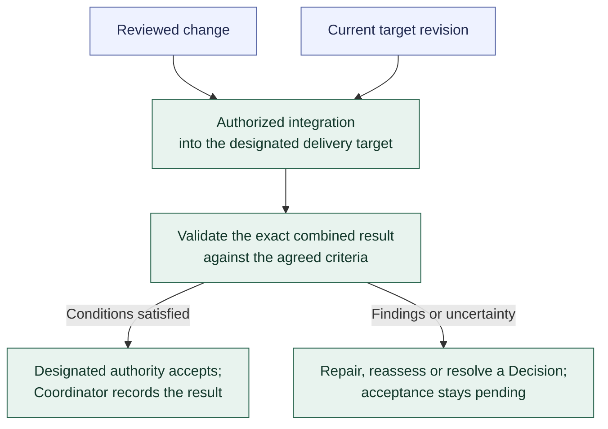

# Integration and combined-result validation

**[A] High-level model.** This view shows integration and exact combined-revision validation within the Task defaults; it does not select Git operations, infrastructure, or exact states. See the [workflow](../workflow.md#integration-and-combined-result-validation).

The Coordinator controls authorization and progression; assigned execution performs integration, and required verification supplies evidence about the combined result. Acceptance follows the delegation and assessment gates. The Task normally includes this work; separately assigned integration remains an explicit exception.

Combined validation asks whether the parts work together and the agreed behavior still holds. Evidence identifies the assessed combined version. Changes to that version require reassessment of affected evidence. Repairs return through [assessment and rework](assessment-and-rework.md).

Task acceptance contributes to the Initiative's overall outcome acceptance. A merge alone establishes neither acceptance nor authority for production deployment.

Previous: [assessment and rework](assessment-and-rework.md). Return to the [diagram guide](README.md).
