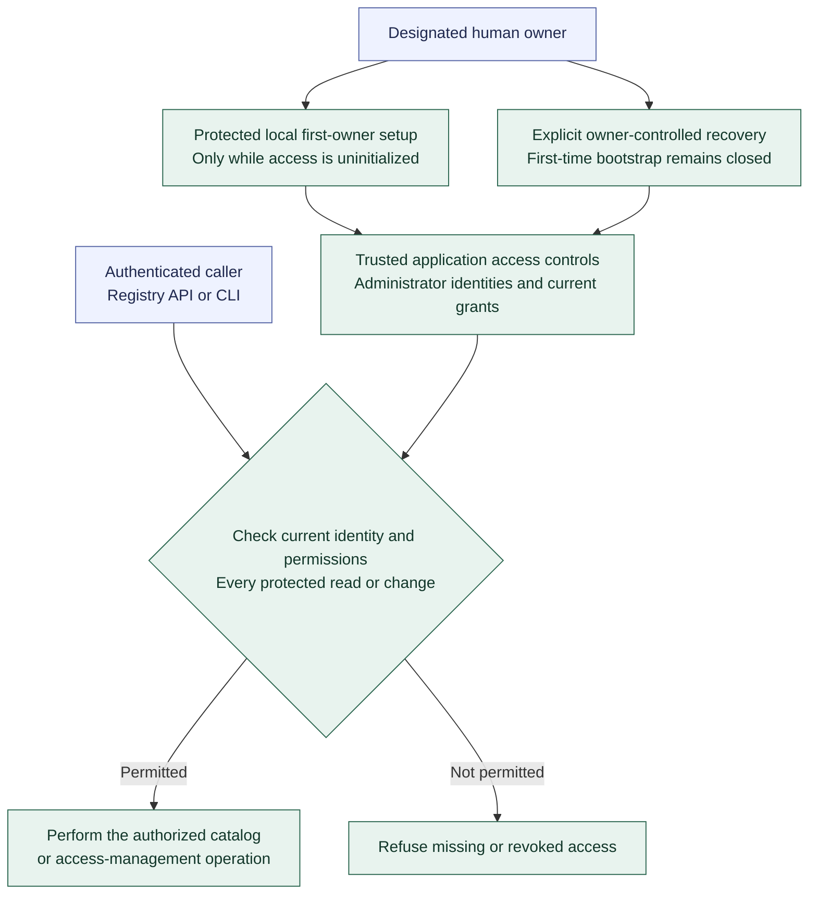

# Registry administrator access and bootstrap authority

**[A] First-owner setup and current access.** This view shows the high-level access boundary under the [Registry administrator rules](../agent-registry.md#administrator-access-and-bootstrap-authority). Authentication technology, physical storage, commands, and the recovery procedure remain specifications.

Begin with one explicitly designated human administrator. Access initialization persists across restart; an empty Agent catalog cannot reopen bootstrap. Protect against accidental loss of the last usable administrator. Foundation local OS operator grants do not automatically grant Registry administration.

Administrator identities and grants remain separate from published Agent definitions and forge accounts. Catalog management and administrative grant management are distinct permissions; the initial owner may hold both. Registry administration does not itself grant execution or delivery-acceptance authority. Agents receive no Registry administration in Increment 2. Later Coordination access uses its own service identity with only the required access to published definitions and current eligibility.

Revocation blocks subsequent protected operations. Retain attributable audit records for bootstrap, access changes, recovery, and catalog operations; credential values stay outside Agent definitions and logs. Continue with [first-Agent preparation](first-agent-preparation.md), [authoring and publication](registry-publication.md), or the [diagram guide](README.md).
