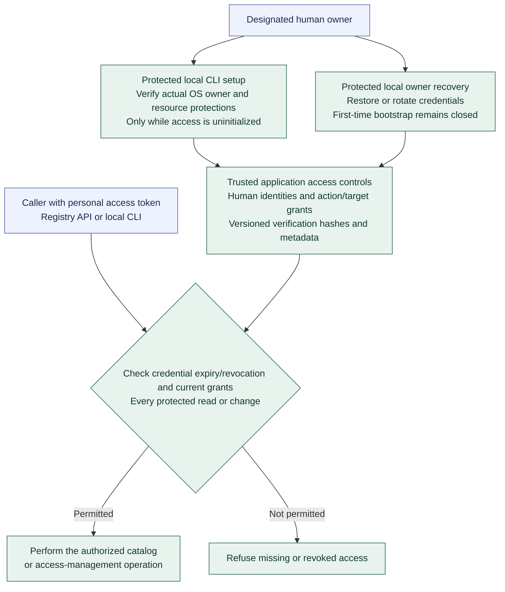

# Registry administrator access and bootstrap authority

**[A] First-owner setup and current access.** This view shows the high-level access boundary under the [Registry administrator rules](../agent-registry.md#administrator-access-and-bootstrap-authority) and [authentication model](../agent-registry.md#authentication-and-protected-first-owner-setup). Exact platform checks, credential formats/lifetimes, commands, and recovery procedures remain specifications.

Begin with one explicitly designated human administrator. Access initialization persists across restart; an empty Agent catalog cannot reopen bootstrap. Protect against accidental loss of the last usable administrator. Foundation local OS operator grants do not automatically grant Registry administration.

Provisioning establishes the trusted OS owner and protects the application's private state paths. Setup and recovery verify the actual OS principal and resource protections using suitable Linux permissions or Windows ACLs. A supplied username or localhost connection is insufficient. Protected local setup establishes the human identity and initial grants and durably closes bootstrap. No running Agent or HTTP server is required.

The focused [protected credential delivery view](registry-credential-delivery.md) saves a new credential securely before registering its verifier and access changes. Recovery uses the same installation-owner boundary and delivery ordering while preserving initialized status, catalog history, and audit provenance. Protect the last usable administrative access unless an established replacement or recovery path is available.

Administrator identities and grants remain separate from published Agent definitions and forge accounts. Grants identify explicit actions and target scopes, distinguishing reading, authoring, reviewing/publishing, controls, and access administration; the initial owner may hold the applicable grants. Registry administration does not itself grant execution or delivery-acceptance authority. Agents receive no Registry administration in Increment 2. Later Coordination access uses its own service identity with only the required access to published definitions and current eligibility.

Cryptographically strong personal access tokens are individually revocable and map to stable human identities; versioned verification hashes and nonsecret credential metadata belong to access-owned records. API and local CLI operations use the same current credential and grant checks, with local administration available without starting the HTTP server. Retain attributable audit records for bootstrap, access changes, recovery, and catalog operations. Raw credentials remain in protected storage, outside command arguments, ordinary configuration values, results, exports, and logs. Continue with [API hosting](registry-hosting.md), [first-Agent preparation](first-agent-preparation.md), or the [diagram guide](README.md).
