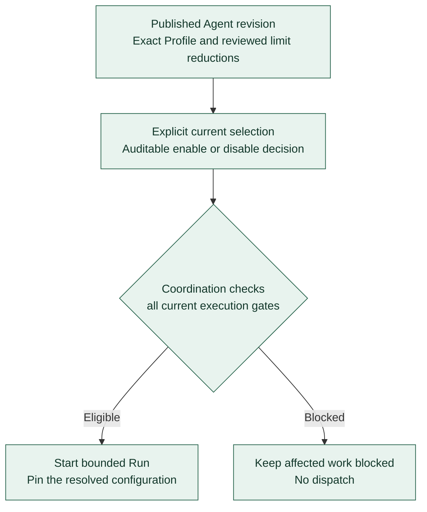

# Registry current controls and permitted overrides

**[A] Published content and current eligibility.** This view separates immutable configuration from current selection and execution gates. The [current controls](../agent-registry.md#current-controls) and [permitted overrides](../agent-registry.md#permitted-overrides) govern the behavior; exact operations and storage contracts remain specifications.

Publication does not automatically select or enable a revision. Current selection and enablement are auditable controls; a historical enabled value cannot bypass current disablement. Coordination also checks current authority, qualification, readiness, holds, capacity, and remaining budgets. Registry eligibility supplies only one condition for execution.

Initially, Agent overrides may only lower explicitly declared execution ceilings, such as duration, retries, tokens, cost, or applicable concurrency. Overrides are explicit, validated, reviewed, and retained in the Agent revision. They cannot expand governing limits or permissions, reset consumed budgets, or introduce silent substitutions. Changes to Role, instructions, runtime, transport, provider/account, model, reasoning, or governing policies use a new reviewed Profile revision.

Resolution respects every applicable numeric ceiling and governing policy. Reject unknown fields, conflicting references, unsupported combinations, and incompatible execution choices. A permitted override still requires applicable qualification; Registry validation checks the definition, and Coordination checks whether the resolved configuration may execute.

Ordinary configuration changes affect future selections. Existing Runs retain their pinned configuration records. Disablement prevents new selection and dispatch; stopping active work remains a separate authorized control. Current revocations and stop controls follow the established enforcement and recovery rules.

Continue with [authoring and publication](registry-publication.md), [Run lifecycle](run-lifecycle.md), or the [diagram guide](README.md).
