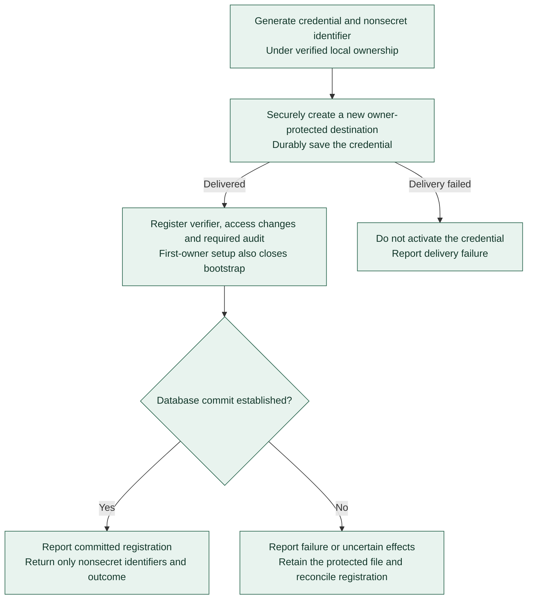

# Protected Registry credential delivery

**[A] Delivery before activation.** This view applies the [protected credential delivery rules](../agent-registry.md#protected-credential-delivery) to first-owner setup, rotation, and recovery. It separates protected filesystem delivery from database registration without defining commands or storage formats.

Filesystem delivery and database registration are separate effect boundaries. If delivery fails, no new credential is activated. If registration fails or its commit is uncertain, retain the protected file and reconcile using the nonsecret identifier. Do not blindly generate a replacement, repeat bootstrap, or revoke an old credential.

Rotation saves the replacement before registering it and revoking the old credential in the controlled database change. Recovery preserves initialized status, catalog history, and audit records. Raw credentials remain outside arguments, ordinary configuration values, results, and logs.

Pending delivery/registration and deliberate credential-file cleanup share cross-process exclusion. Cleanup reports unavailable while registration is pending; after acquiring exclusion it reconciles afresh before removal. The stable lock sidecar remains in place. These controls preserve the separate filesystem/database boundaries and are described in the [credential lifecycle contract](../registry-contracts.md#owner-tokens-delivery-and-recovery).

Continue with [administrator access](registry-access.md), [operations and persistence](registry-operations.md), or the [diagram guide](README.md).
