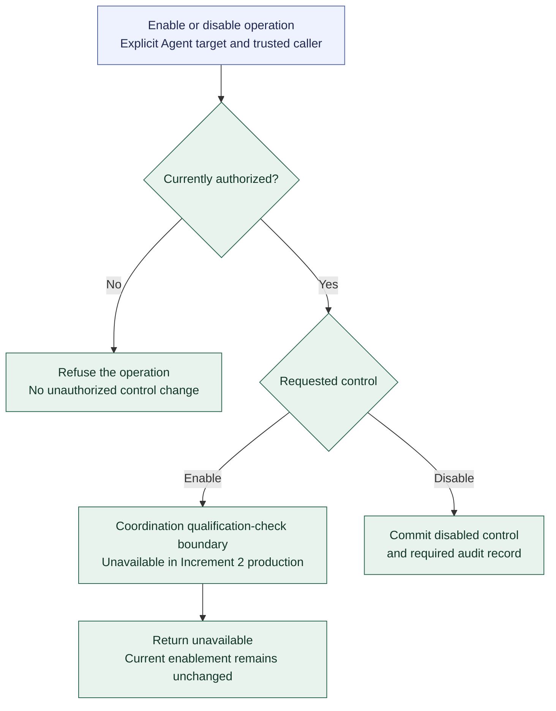

# Registry enablement before Coordination qualification

**[A] Disabled preparation and unavailable enablement.** This view applies the [enablement boundary](../agent-registry.md#enablement-before-coordination-qualification) to Increment 2. It describes logical outcomes without defining exact commands, reason codes, or qualification records.

Enablement remains a recognized operation. An authorized request returns an explicit unavailable outcome while qualification cannot be checked, with no change to current enablement. Authorized disablement remains available independently of qualification. Publishing and selecting disabled Agent revisions continue through their ordinary validation and authority checks.

Coordination owns the future qualification check. Increment 2 does not create qualification records or accept an administrator-supplied qualified assertion. No pending-enable state, forced-enable flag, or additional approval queue is introduced. All five initially prepared Agents remain disabled.

When qualification becomes available, an administrator must explicitly request enablement and pass fresh checks against the exact selected configuration; availability does not enable anything automatically. Selecting another configuration cannot carry qualification forward automatically.

A stored or recovered enabled flag does not prove present execution eligibility. Report administrative state separately from qualification availability and preserve history. Positive qualification test doubles remain isolated from production composition and bootstrap evidence.

Continue with [current controls and overrides](registry-controls.md), [first-Agent preparation](first-agent-preparation.md), or the [diagram guide](README.md).
