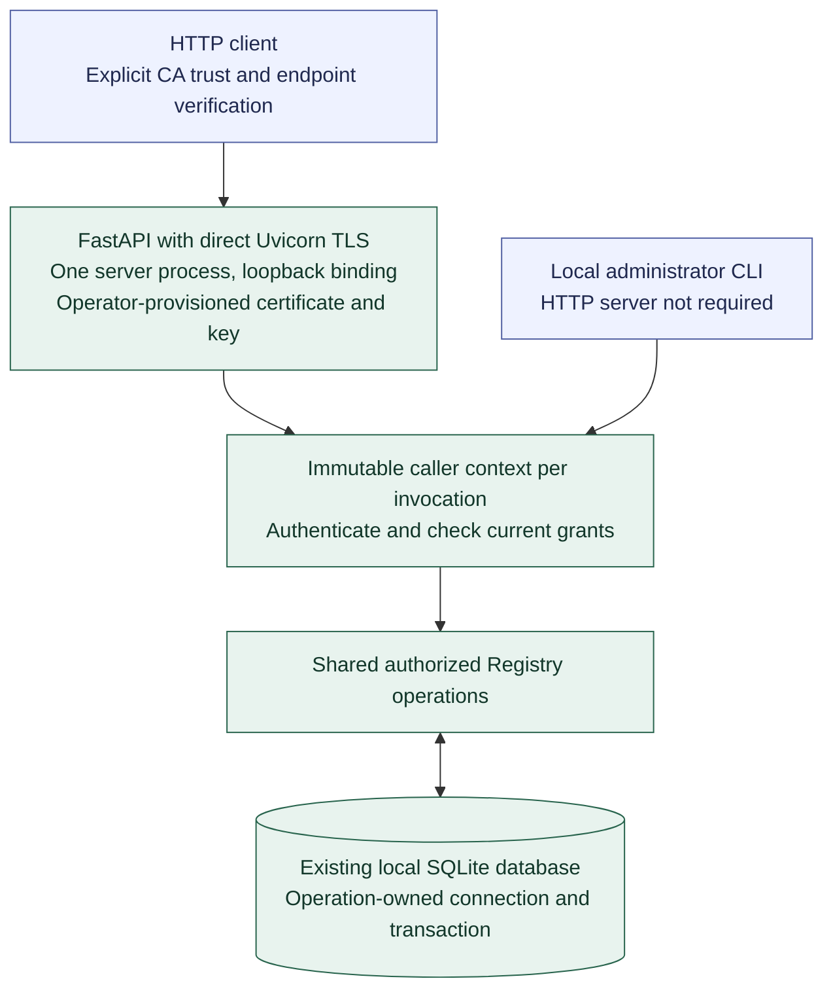

# Registry API hosting

**[A] Shared application and authenticated operations.** This view applies the [API hosting model](../agent-registry.md#api-hosting) and [authentication rules](../agent-registry.md#authentication-and-protected-first-owner-setup). It shows logical entry paths, not exact commands, API endpoints, or deployment packaging.

Bind to loopback initially. Credential-bearing HTTP access uses HTTPS, initially terminated directly in Uvicorn with externally provisioned certificate/key files. Clients explicitly trust the issuing CA and verify endpoint identity. Provisioning certificates and changing trust remain operator actions; broader exposure requires explicit configuration.

Choose FastAPI/Uvicorn versions verified with CPython 3.14.10, pin the tested direct dependencies, and retain the complete resolution in `uv.lock`. Let FastAPI select compatible Starlette. Extend the existing strict configuration resolver for hosting settings and protected-file references, then pass resolved settings to Uvicorn programmatically.

API and CLI retain the same operations and ownership. Create an immutable trusted caller context per invocation, sharing services rather than mutable authenticated caller state. Each synchronous database operation owns its connection and transaction within one execution context.

Integrate hosting with one coordinated application lifecycle and signal owner. Distinguish listener readiness, administrative availability, and Agent eligibility. Listener readiness follows successful initialization and binding; protected administration remains locked before owner setup, while unavailable qualification does not prevent catalog administration.

On shutdown, withdraw readiness, stop admitting work, drain active operations within a configured deadline, then close resources once. A disconnected or cancelled HTTP request does not prove its database mutation rolled back. Exact package pins, port/certificate selectors, trust instructions, numeric settings, and lifecycle integration contracts remain implementation details.

Continue with [administrator access](registry-access.md), [Registry ownership](registry-organization.md), or the [diagram guide](README.md).
