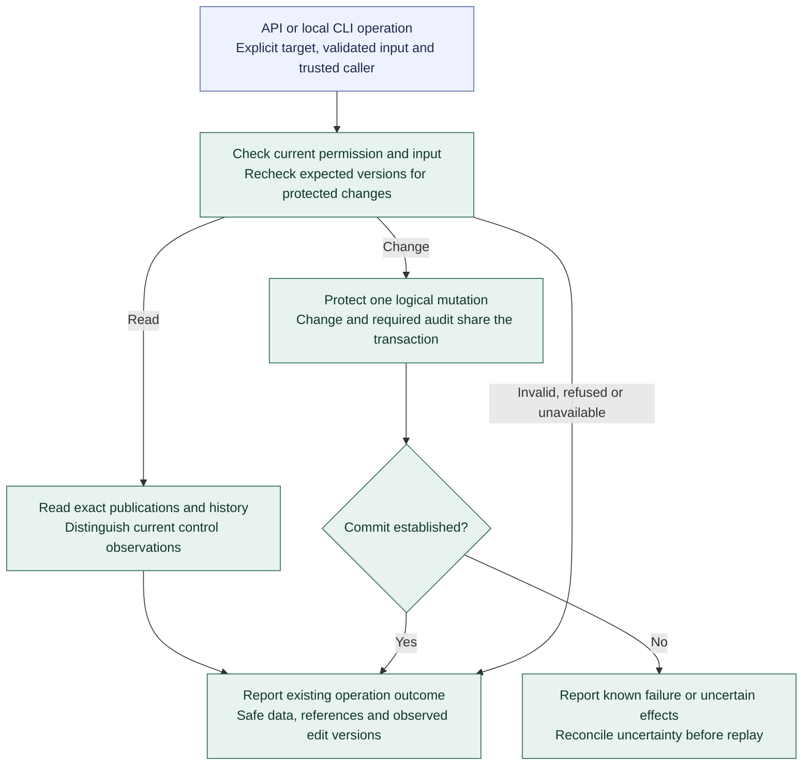

# Registry operations and persistence

**[A] Shared contracts and protected changes.** This view summarizes the [operation contracts](../agent-registry.md#operation-contracts) and [persistence boundaries](../agent-registry.md#persistence-and-failure-boundaries). It shows logical handling rather than exact endpoints, schemas, or result formats.

The logical operation groups cover authoring, assessment/publication, exact retrieval, current controls, and access administration. Catalog editing and access administration retain distinct permissions. Initial preparation composes ordinary operations without a privileged bulk bypass. Results retain the foundation's six outcomes while adding safe business data and created or observed revision references.

Targets distinguish stable identities, drafts, exact publications, current controls, and access records. Creation identifies the intended new identity or collection. Mutable edit versions remain distinct from immutable publication IDs; exact resolution never silently selects latest. Check expected versions for changes within their transaction, and reject stale or conflicting changes rather than merging them automatically.

Use strict operation-specific inputs and safe read results, excluding credential verification material. Declared override fields have explicit units and bounds and permit only ceiling reductions; reject unknown fields, invalid types, conflicts, and increases. Zero and unspecified meanings are field-specific. API and CLI report the same logical result, supplemented by transport or exit codes.

Reuse the shared SQLite, SQLAlchemy Core, and Alembic foundation. The application owns commit/rollback. Registry-owned records distinguish stable identities, versioned drafts, exact-candidate reviews, immutable publications/dependencies, versioned current controls, and audit. Access-owned records retain human identities, credential verification, grants, and initialized state. Enforce identity/revision uniqueness, expected mutable versions, and valid published references. Incomplete drafts remain possible; publication establishes completeness. Logical ownership does not require another database.

Publication rechecks the candidate version, review applicability, exact dependencies, and current restrictions before committing. Preserve publications and dependencies required by historical references. Short transactions do not span human review or external work.

Atomicity applies to each logical operation. If initial preparation fails after earlier publications succeeded, those publications remain; resume inspects existing results. A failed publication leaves no partial published result of its own. Retries need operation-specific guarantees; an invocation identifier alone does not make replay safe.

Reads repeat under current authorization. Writes enforce identity uniqueness or expected mutable versions; preparation resumes through lookup and reconciliation. No general automatic write-replay guarantee is introduced.

Record unsuccessful attempts separately from rolled-back changes and report unavailable audit storage honestly. A mutation cannot succeed if its required audit cannot commit. Report verified rollback as known failure and retain uncertainty when effects cannot be established.

The [retention and reconciliation rules](../agent-registry.md#retention-and-reconciliation) preserve published revisions, required dependencies, review provenance, and audit history without hard deletion in Increment 2. Authorized draft discard preserves required history. Raw credential-file cleanup is separate and follows known registration/revocation status; retain nonsecret credential identifiers and revocation history.

Reconciliation inspects exact revisions, control versions, and correlated audit records. Later state may differ from the result of an earlier operation, so current state alone may not establish its outcome. Preserve uncertainty when evidence is insufficient. Preparation compares already committed publications with reviewed inputs; credential registration is reconciled using its nonsecret identifier while the file remains protected. Physical tables, exact result mappings, cleanup procedures, and audit-outage details remain implementation contracts.

Continue with [authoring and publication](registry-publication.md), [first-Agent preparation](first-agent-preparation.md), the [operation contracts](../registry-contracts.md), or the [diagram guide](README.md).
