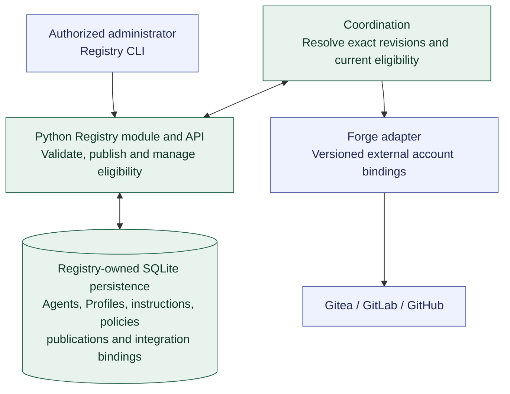

# Agent Registry API and persistence

**[A] Forge-independent Registry.** The Registry is a Python module in `mobiraeon` with its own API and SQLite persistence under [D-05](../decisions.md#d-05-registry). See the [Registry description](../agent-registry.md) and [first-Agent preparation](first-agent-preparation.md).

Registry and Coordination initially share the application and local SQLite database while owning separate tables and operations. Published configuration revisions are immutable; current administrative eligibility is checked before new dispatch. Versioned project bindings select external identities without granting authority beyond governing policy. The forge nodes show the adapter boundary; Gitea is the initial integration, and other adapters require their own qualification.

Live work, qualification references, and immutable per-Run records belong to Coordination; substantial evidence belongs to Artifacts, and credential values to the secret-management mechanism. Git import/export is optional and does not become another authoritative Registry. Continue with [Agent setup and Gitea](agent-setup-and-gitea.md) or return to the [diagram guide](README.md).
