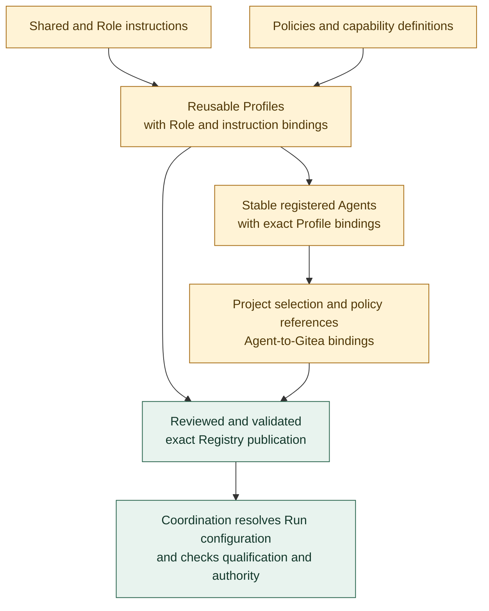

# Agent Registry organization

**[P] Repository organization proposal.** Amber nodes show the proposed catalog areas. Publication and Coordination retain the boundaries established by [D-05](../decisions.md#d-05-registry). See the [Registry discussion](../agent-registry.md) for the proposed first Agents.

The publication includes all referenced definitions and uses the validation contracts in the proposed `schemas/` area. Project bindings select reusable definitions; they do not grant permissions beyond governing authority.

Live work, qualification references, and immutable per-Run records belong to Coordination; substantial evidence belongs to Artifacts, and credential values to the secret-management mechanism. Continue with [Agent setup and Gitea](agent-setup-and-gitea.md) or return to the [diagram guide](README.md).
