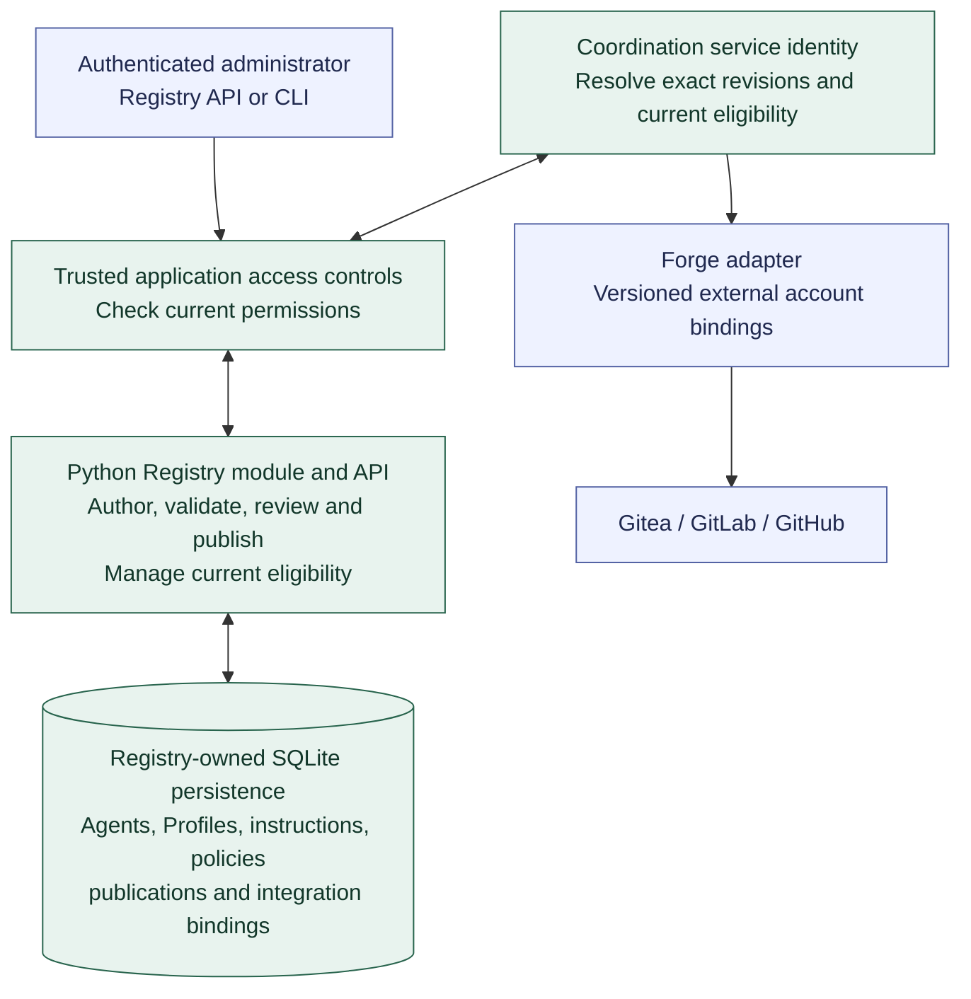

# Agent Registry API and persistence

**[A] Forge-independent Registry.** The Registry is a Python module in `mobiraeon` with its own API and SQLite persistence under [D-05](../decisions.md#d-05-registry). See the [Registry description](../agent-registry.md) and [first-Agent preparation](first-agent-preparation.md).

Registry and Coordination initially share the application and local SQLite database while owning separate tables and operations. The focused [administrator access view](registry-access.md) covers first-owner setup, current permissions, and recovery; access controls remain separate from the publishable catalog. API and CLI operations use the same authorization boundary, including protected reads by the Coordination service identity. The [authoring and publication view](registry-publication.md) covers editable drafts, exact-content review, and immutable publications. The [current controls view](registry-controls.md) separates explicit selection and enablement from historical content and later execution gates. Versioned project bindings select external identities without granting authority beyond governing policy. The forge nodes show the adapter boundary; Gitea is the initial integration, and other adapters require their own qualification.

The [hosting view](registry-hosting.md) shows FastAPI and Uvicorn within the existing application, initially one server process with loopback binding and HTTPS for credential-bearing HTTP access. Local CLI administration uses the same authenticated operations without requiring the HTTP server. Hosting integrates with one coordinated application lifecycle and shared SQLite ownership.

The [operations and persistence view](registry-operations.md) covers shared input/result contracts, per-operation transactions, required audit records, and the distinction between Registry-owned and access-owned data. Initial preparation composes these operations; earlier successful publications survive a later preparation failure.

Live work, qualification references, and immutable per-Run records belong to Coordination; substantial evidence belongs to Artifacts, and credential values to the secret-management mechanism. Git import/export is optional and does not become another authoritative Registry. Continue with [Agent setup and Gitea](agent-setup-and-gitea.md) or return to the [diagram guide](README.md).

The [enablement view](registry-enablement.md) records the Increment 2 boundary: qualification is unavailable, enable requests cannot change current enablement, and authorized disablement remains usable. Later Coordination service access and execution gates retain their separate ownership.
