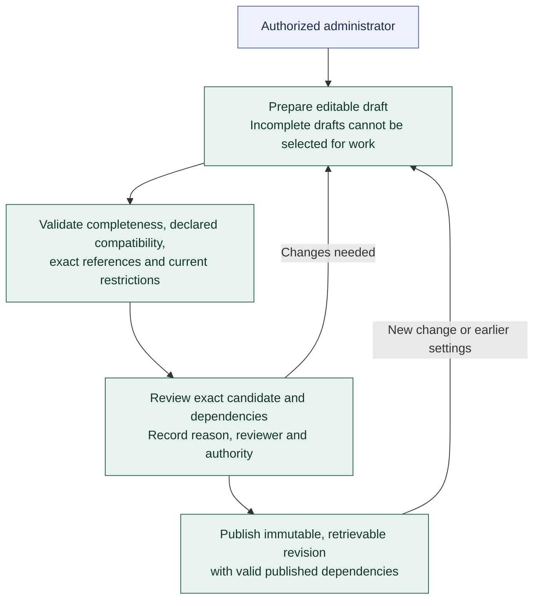

# Registry authoring and publication

**[A] Drafts and immutable publications.** This view shows the high-level authoring path for Agents, Profiles, instructions, policies, and capability definitions. The [Registry rules](../agent-registry.md#authoring-and-publication) govern validation, review, publication, and later changes.

The same authorized human may author, review, and publish where policy permits; record the actions distinctly. A separate reviewer is required when policy calls for one. Editing the reviewed candidate requires renewed review. A failed publication leaves no partial published result. Validation establishes configuration validity; runtime qualification remains separate.

Published Profile changes do not change Agents pinned to earlier revisions. Moving an Agent to a different Profile revision is an explicit reviewed change. Publication does not enable or qualify an Agent. Historical content remains retrievable while current disablement, revoked access, and governing restrictions still apply. Restoring earlier settings creates a new reviewed revision under current checks and preserves history.

Continue with [first-Agent preparation](first-agent-preparation.md) or return to the [Registry API and persistence](registry-organization.md) or [diagram guide](README.md).
