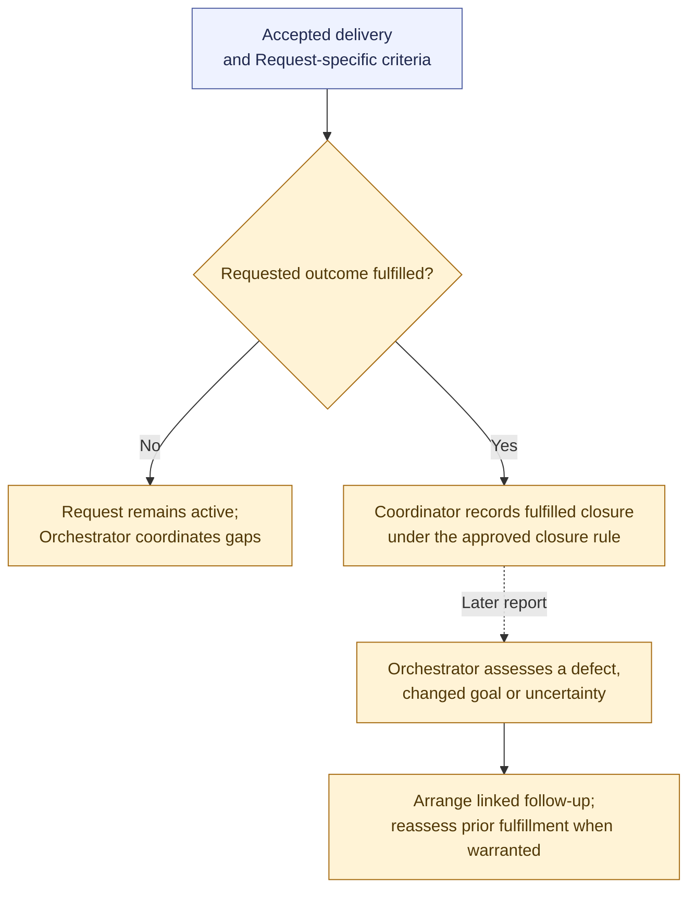

# Request closure and follow-up

**[P] Proposed high-level model.** Request fulfillment follows its own agreed outcome and applicable delivery evidence. The Request remains an origin record outside the Project → Initiative → Task hierarchy. See the [workflow proposal](../workflow.md#proposed-request-closure-and-follow-up).

An approved closure rule may use existing accepted outcomes without another approval or Agent Run. Request-specific questions need the appropriate delegated authority; Task or Initiative authority alone does not supply a broader grant. Gitea closure reflects the recorded determination.

Before acceptance, ordinary corrections remain same-Task rework. After closure, defects normally lead to linked repair work and changed goals to a linked new Request. Preserve the original scope and evidence. If later findings undermine the recorded fulfillment, reassess and correct affected records or reopen work through authorized policy.

Cancellation, rejection, or duplicate handling closes work for a different reason from fulfillment. Uncertain reports need investigation or a Decision before classification; changes to governing scope follow the existing authority process.

Related: [Initiative outcome acceptance](initiative-acceptance.md). Return to the [diagram guide](README.md).
