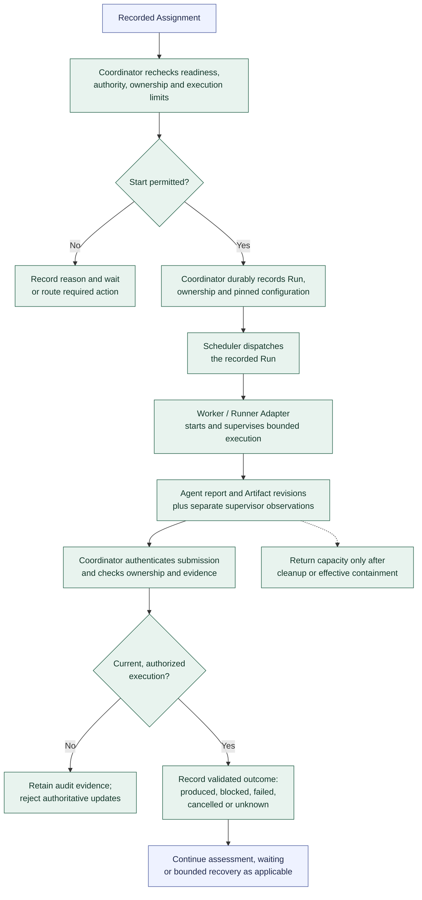

# Run launch and result reporting

**[A] Agreed high-level design.** This shared lifecycle applies to every Agent stage, including Orchestrator reasoning, authoring, independent review, verification, and Agent-performed integration. It does not define exact states or API messages. The [workflow](../workflow.md#run-launch-and-result-reporting) owns the rules.

The Agent receives shared rules, Role instructions, the Assignment, permitted context, and an output contract. Trusted execution controls enforce permissions and limits outside the prompt. Reports identify work, exact revisions, checks and environments, limitations, and unresolved questions; a successful exit or a completion claim does not establish acceptance.

| Recorded outcome | Continuation |
| --- | --- |
| Produced work or assessment evidence | Continue with [assessment and rework](assessment-and-rework.md); assessment reports contribute evidence rather than automatically starting another review of themselves. |
| Blocked work | Preserve progress and the unmet condition. Use an eligible Orchestrator Assignment when interpretation or a Decision is needed; waiting needs no active model. |
| Failed attempt | Follow bounded recovery while preserving Task identity, evidence, and cumulative limits. A changed configuration requires a new authorized Run. |
| Unknown or interrupted outcome | Reconcile launches and external effects before repeating an operation. A missing acknowledgement does not establish success or permission to retry blindly. |
| Cancellation | Record the authorized stop, retained work, and uncertain effects. |

Capacity cleanup is independent of acceptance. Duplicate dispatches and reports must converge without duplicate launches or accepted work. Follow-up Agent work returns through [assignment and selection](assignment-and-selection.md) and this same lifecycle.

Previous: [assignment and selection](assignment-and-selection.md). Next: [assessment and rework](assessment-and-rework.md). Return to the [diagram guide](README.md).
