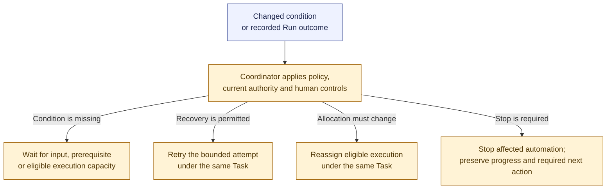

# Waiting and recovery

**[P] High-level routing proposal.** Durable waiting, bounded recovery, preserved history, and exclusive ownership already follow the baseline. This view summarizes the next-action choices in the [workflow proposal](../workflow.md#proposed-waiting-and-recovery).

Waiting uses no active model merely to monitor a condition. Capacity waiting does not itself remove Task readiness. Retry and reassignment preserve Task identity, earlier evidence, and cumulative limits; uncertain effects are reconciled before repeating operations.

Reassignment uses an eligible authorized allocation and preserves exclusive execution ownership. Affected capacity returns only after cleanup or effective containment. Durable human holds also constrain recovery; a restart or available Worker does not release a pause or cancellation.

Stopping an attempt or automatic dispatch does not establish Task cancellation or acceptance. The Orchestrator handles judgment when eligible; otherwise the required action remains visible without bypassing controls or limits.

Related: [Run lifecycle](run-lifecycle.md) and [human controls](human-controls.md). Return to the [diagram guide](README.md).
